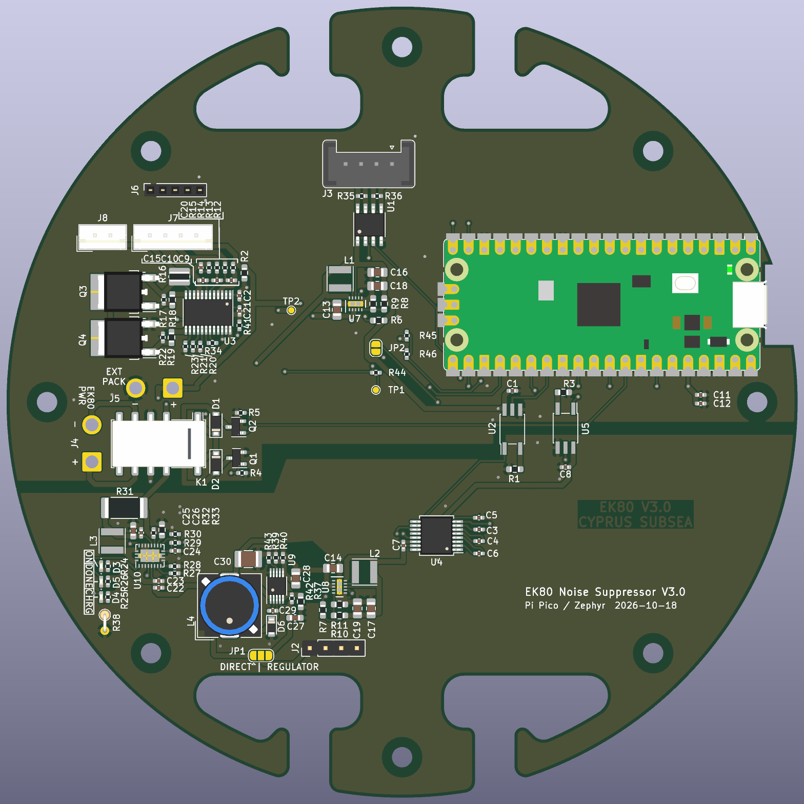
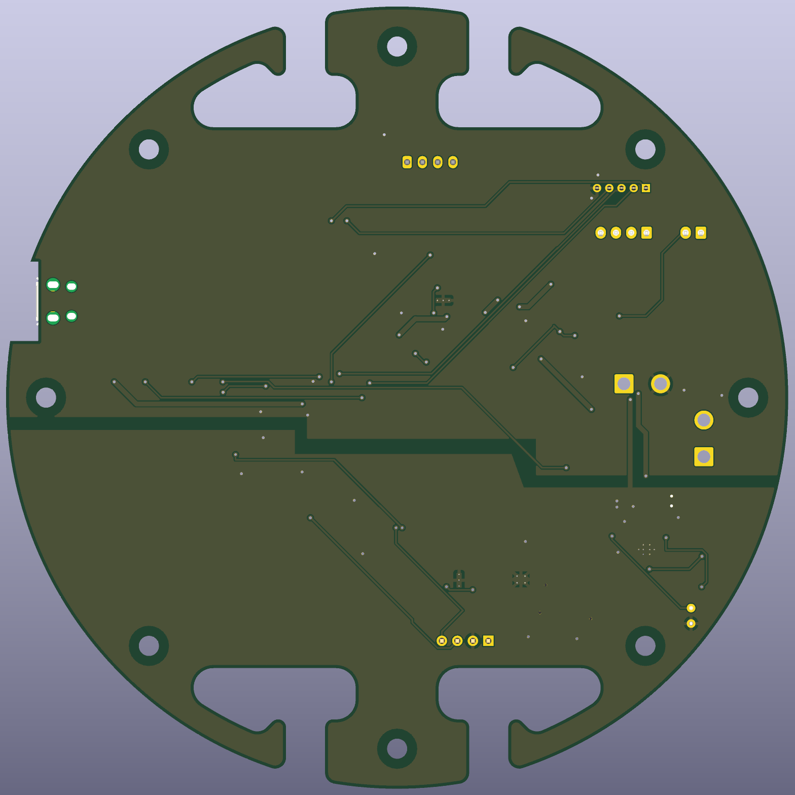

# EK80 noise suppressor V3.0 (Raspberry Pi Pico)

Interface board between a Seaglider and an EK80 echosounder: galvanically
isolated glider link, RS-422 to the EK80, an on-board pack with protection
and charger, and a latching relay that connects the pack either to the EK80 or
to the charger.

## Pin map

| Pico pin | GPIO | Net | Use |
|---|---|---|---|
| 21 / 22 | GP16 / GP17 | STX / SRX | UART0 to the EK80 (U1, J3) |
| 26 / 27 | GP20 / GP21 | GTX / GRX | UART1 to the glider (U5/U2, U4, J2) |
| 29 | GP22 | RELAY_SET | relay pulse: pack → charger |
| 32 | GP27 | RELAY_RESET | relay pulse: pack → EK80 |
| 31 | GP26 / ADC0 | VBAT_SENSE | pack voltage (10k / 2.4k) |
| 34 | GP28 | BMS_PRES | bq77915 PRES via JP2 |
| 24 / 25 | GP18 / GP19 | SDA / SCL | J6 (BQ76920), I2C1 |
| 19 / 20 | GP14 / GP15 | ALM / BOOT | J6 |
| 36 | 3V3 | SENSOR3.3V | supply in |
| 37 | 3V3_EN | PACK- | module regulator off |
